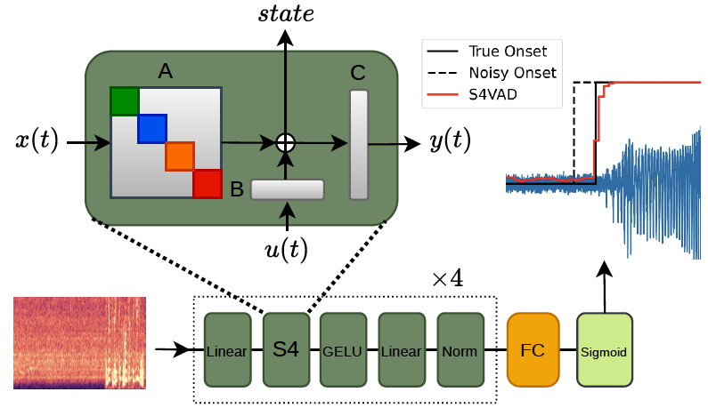

# Low-Latency State Space Voice Activity Detection with Robust Onset Time Evaluation

## 📄 Paper

## Abstract
Voice Activity Detection (VAD) systems are commonly
evaluated using metrics such as the area under the
receiver operating characteristic curve (AUROC), but these
metrics do not account for temporal responsiveness. For lowlatency
applications, however, accurately measuring speech onset
delay is essential. This is particularly challenging because onset
latency evaluation is affected by noise and systematic misalignment
in annotation timestamps. In this work, we introduce a
probabilistic framework for evaluating VAD onset time under
noisy temporal labels. We model annotated onset times as noisy
observations of latent acoustic onsets and estimate the resulting
discrepancy distribution from data. We show that this approach
provides a more stable and robust estimate of algorithmic latency.
In addition, we introduce S4VAD, the first state-space-modelbased
(SSM-based) VAD architecture. S4VAD supports efficient
streaming inference while directly controlling the decay of past
acoustic evidence, enabling fast and responsive speech-onset
detection. We evaluate VAD onset latency across several lowlatency
architectures, including CNN, Transformer, and RNN
models. Our proposed VAD achieves the lowest latency while
maintaining a competitive AUROC.



## Requirements
**python version 3.12**

## Installation
To install the necessary dependencies, run the following commands:
 ```shell script
 git clone https://github.com/arm-research/AAIR-S4VAD
 cd AAIR-S4VAD
 pip install -r requirements.txt
 ```

## 💾 Training and Validation Datasets
### LibriSpeech
LibriSpeech is a large-scale, high-quality speech dataset derived from audiobooks, 
commonly used for VAD and speech processing tasks due to its clean recordings and precise speech segmentation.

Download: [LibriSpeech](https://www.openslr.org/12)

train-validation-test splits:
[train-clean-100.json](https://github.com/arm-research/AAIR-S4VAD/releases/download/v0.1/train-clean-100.json)
[dev-clean.json](https://github.com/arm-research/AAIR-S4VAD/releases/download/v0.1/dev-clean.json)
[test-clean.json](https://github.com/arm-research/AAIR-S4VAD/releases/download/v0.1/test-clean.json)

### DNS2023
The DNS 2023 noise dataset provides a large and diverse collection of real-world noise
recordings curated for speech enhancement and VAD, covering a wide range of acoustic environments
and background conditions.

Download: [DNS noise download script](https://github.com/microsoft/DNS-Challenge/blob/master/download-dns-challenge-5-noise-ir.sh)

Create train-validation-test splits by this script: [create_dataset_split](s4vad/vad/scripts/create_dataset_split.py)

## 💾 Testing Datasets
### AVA speech
The AVA-Speech dataset annotates speech activity for the movie clips in the AVA v1.0 dataset. 
It explicitly labels 3 background noise conditionscontain (Clean Speech, Speech with background Music, 
and Speech with background Noise), resulting in ~40K labeled segments spanning 40 hours of data.
This dataset contains audios and their Speech/Noise labels for 2000 samples per class.

Download: [ava_speech](https://sites.research.google/gr/ava/download/)

## 🔬 Noisy Onset Evaluation

The Silero configuration uses the `noisy_onset_evaluator` to estimate onset
label noise. Set `dataset_cfg.val_ds.path` and `noise_path` in
`s4vad/vad/configs/silero.yaml`, then run:

```shell
python eval.py -y s4vad/vad/configs/silero.yaml
```

## 💻 Training

1. **Configuration:** edit `s4vad/vad/configs/s4vad_train.yaml` and set the
   dataset locations for your environment:
   - `dataset_cfg.train_ds.path`: training speech JSON manifest.
   - `dataset_cfg.train_ds.noise_path`: training noise JSON manifest or WAV directory.
   - `dataset_cfg.val_ds.path`: validation speech JSON manifest.
   - `dataset_cfg.val_ds.noise_path`: validation noise JSON manifest or WAV directory.
   - `trainer_cfg.out_dir`: directory where training outputs are saved.
2. **Run training:**

   ```shell
   python train.py -y s4vad/vad/configs/s4vad_train.yaml
   ```

The trainer saves the best checkpoint and a copy of the configuration in the
configured output directory.

## 🔬 Evaluation

1. **Configuration:** edit `s4vad/vad/configs/s4vad.yaml` and set:
   - `dataset_cfg.val_ds.path`: validation/test speech JSON manifest.
   - `dataset_cfg.val_ds.noise_path`: validation/test noise JSON manifest or WAV directory.

   For AVA-Speech evaluation, change `dataset` to `avaspeech` and set
   `dataset_cfg.val_ds.path` to the AVA-Speech dataset folder. The config uses
   the pretrained `checkpoints/s4vad_10ms.pth` checkpoint by default.
2. **Run evaluation:**

   ```shell
   python eval.py -y s4vad/vad/configs/s4vad.yaml
   ```

To evaluate another local PyTorch checkpoint, pass
`-p /path/to/checkpoint.pth`.

## ✈️ Inference

1. **Configuration:** `s4vad/vad/configs/s4vad.yaml` uses
   `checkpoints/s4vad_10ms.pth` by default.
2. **Run inference** on a WAV file:

   ```shell
   python infer.py -y s4vad/vad/configs/s4vad.yaml -i samples/clean1.wav
   ```

Inference saves the activity plot as `vad.png` and intermediate test vectors
as `test_vectors.npz` in the current directory.
